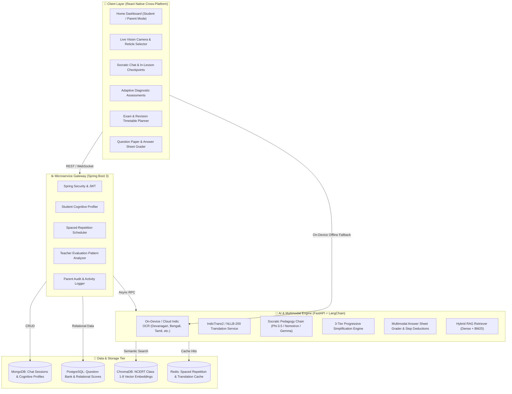
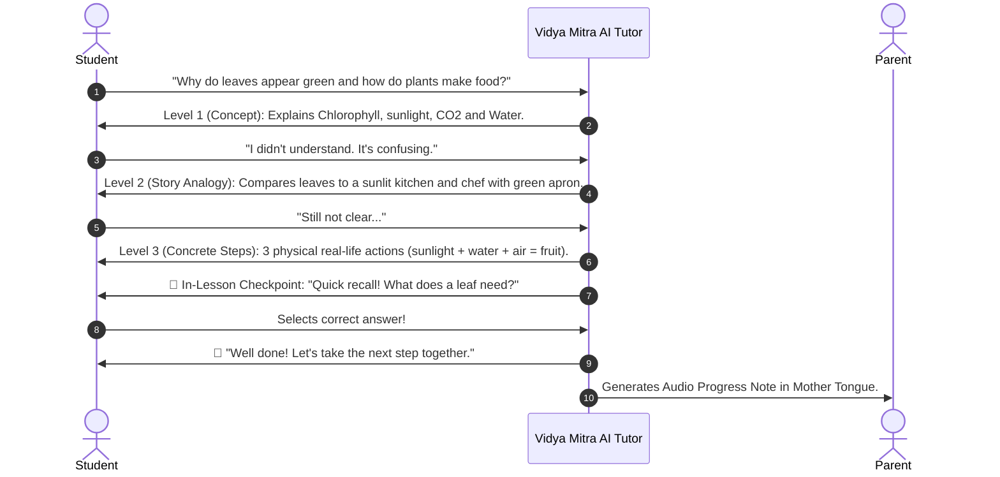
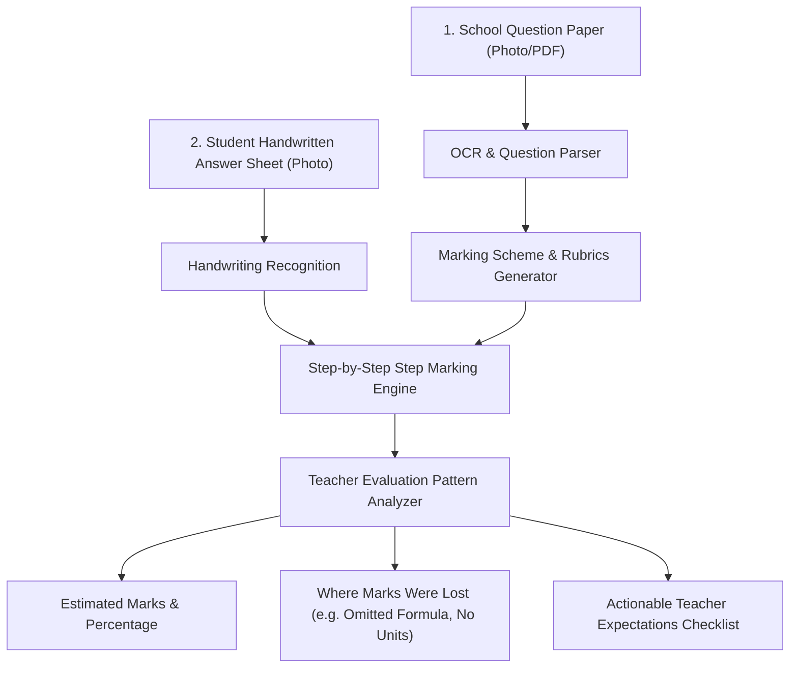

# 🏛️ Vidya Mitra — System & Pedagogical Architecture

Vidya Mitra is designed as a distributed, privacy-first, cross-platform educational platform tailored for Indian students (Classes 1 to 8) and their families.

---

## 🏗️ High-Level System Architecture



---

## 🧩 Pedagogical Core: Progressive Simplification Cascade

To break the "mug-up" (rote learning) culture and protect slow or shy learners from embarrassment, Vidya Mitra enforces a 3-tier progressive simplification cascade:



---

## 📄 Question Paper & Answer Sheet Grading Architecture



---

## 🗄️ Database Schemas

### 1. MongoDB: Student Cognitive Profile
```json
{
  "_id": "673f1a2b89c0",
  "fullName": "Aarav Sharma",
  "grade": 4,
  "motherTongue": "hi",
  "currentStreakDays": 7,
  "cognitiveLevel": 2,
  "identifiedWeaknesses": [
    "Speed & Time Problems",
    "Logical Word Puzzles"
  ],
  "topicMastery": {
    "Numbers & Place Value": 95,
    "Fractions & Decimals": 78,
    "Speed, Distance & Time": 42,
    "Logical Reasoning": 35
  }
}
```

### 2. MongoDB: Exam Schedule & Spaced Repetition
```json
{
  "_id": "sched_9921",
  "studentId": "673f1a2b89c0",
  "examTitle": "Mid-Term Examination",
  "examDate": "2026-11-25",
  "daysRemaining": 10,
  "revisionPlan": [
    {
      "cycleName": "Phase 1: Concept & Story Foundations",
      "startDate": "2026-11-15",
      "endDate": "2026-11-18",
      "dailyTasks": ["NCERT Chapter 3 review", "10-question diagnostic quiz"]
    },
    {
      "cycleName": "Phase 2: Deep Practice & Weak Area Drills",
      "startDate": "2026-11-19",
      "endDate": "2026-11-22",
      "dailyTasks": ["Word problem drills", "Formula practice"]
    },
    {
      "cycleName": "Phase 3: Mock Exam & Teacher Rubrics Polish",
      "startDate": "2026-11-23",
      "endDate": "2026-11-25",
      "dailyTasks": ["Timed full mock test", "Answer sheet evaluation"]
    }
  ]
}
```
